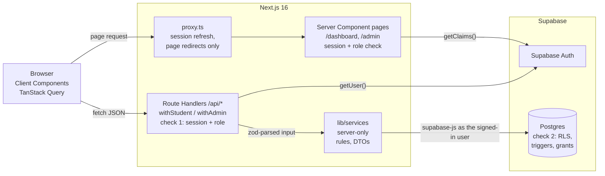

# Mini-LMS

Students book and manage consultations; admins see every consultation, read-only. Built with Next.js 16 (App Router), TypeScript and Supabase (Postgres, Auth, row-level security).

Security sits in two layers: every API route checks the session and the role, and Postgres row-level security (RLS) is the final guard, so a missed check in one layer is caught by the other.

> **Checked from a fresh clone** on 22 Nov 2026 (macOS, Node.js 24.18, OrbStack): `git clone`, then [Setup](#setup) and the [Review path](#review-path) word by word, then lint, typecheck, `npm run test:coverage` and `npm run test:e2e`. Everything passed. The one fix it needed (the lockfile took its project name from the folder) is in the history as `chore: fixes from fresh-clone check`.

## Contents

[Features](#features) · [Prerequisites](#prerequisites) · [Review path](#review-path) · [Setup](#setup) · [Architecture](#architecture) · [Consultation states](#consultation-states) · [Security and roles](#security-and-roles) · [API](#api) · [Tests](#tests) · [Key decisions](#key-decisions) · [Assumptions](#assumptions) · [Future work](#future-work-and-known-limitations)

## Features

Every feature in the brief is delivered, enforced in the API and again in the database.

| Feature | UI | API | Enforced in the database by |
| --- | --- | --- | --- |
| Sign up, log in, log out | `/auth/*` pages, logout in the header | Supabase Auth | A trigger creates a `profiles` row with role `student` |
| List own consultations | `/dashboard`, sorted by consultation time, status badge | `GET /api/consultations` | RLS: students select their own rows only |
| Book (first name, last name, reason, date and time) | Booking dialog | `POST /api/consultations` | Column grants limit the insert to four fields; `student_id` defaults to `auth.uid()`; a trigger rejects past times; a unique index blocks double booking |
| Mark complete or incomplete | **Done** checkbox, optimistic update | `PATCH /api/consultations/:id` `{ completed }` | Trigger: only scheduled ⇄ completed, past bookings included; the database sets the time |
| Reschedule | Date and time dialog | `PATCH /api/consultations/:id` `{ scheduledAt }` | Trigger: only from scheduled, future times only |
| Cancel | Confirm dialog | `POST /api/consultations/:id/cancel` | Trigger: only from scheduled; sets `cancelled_at` (the row stays) |
| Admin view of all consultations, read-only | `/admin` with student name and ID, **Load more** | `GET /api/admin/consultations?cursor=` | RLS: admins select every row; every write policy requires a non-admin |
| Roles | **Admin** link shown only to admins | `withStudent` on every student route (an admin gets 403), `withAdmin` on the admin route | `profiles.role`, `is_admin()`, no user writes to `profiles` |

## Prerequisites

| Tool | Version | Notes |
| --- | --- | --- |
| Node.js | 24 (see `.nvmrc`) | npm 11 comes with it |
| Container runtime | Docker Desktop or OrbStack | Must be running before `npx supabase start` |

Every package version, including the Supabase CLI, is pinned by `package-lock.json`. The CLI is a dev dependency, so there is nothing to install globally.

Versions used: Next.js 16.4.6, React 19, `@supabase/ssr` 0.12, `@supabase/supabase-js` 2.119, Supabase CLI 3.2, Postgres 17, TanStack Query 5, zod 4, Vitest 5, Playwright 1.65.

## Review path

About five minutes, after [Setup](#setup). Seed accounts share the password `password123` (see [Seed accounts](#seed-accounts)). T1 and T2 are any two future times, for example tomorrow at 10:00 and 11:00.

1. Complete [Setup](#setup), then open http://localhost:3000. Signed out, it goes to the login page.
2. Sign up a new account at `/auth/sign-up`. Local sign-up needs no email confirmation, so it lands straight on an empty dashboard.
3. Log out and log in as `student.a@example.com`. Book T1 with **Book a consultation**. Tick its **Done** box to mark it complete, then untick it to mark it incomplete.
4. **Reschedule** it from T1 to T2. While T2 is still active, book T1 again: it succeeds, so rescheduling freed T1. Booking T2 a second time is refused with "You already have a consultation at this time."
5. **Cancel** the T2 booking and confirm, then book T2 again: it succeeds, so cancelling freed T2. The cancelled row stays in the list, struck through.
6. Tick **Done** on A's seeded "Catch-up on last week's lab", marked *(past)*: past bookings can still be completed.
7. Log out. `/dashboard` now redirects to the login page, and `curl -i http://localhost:3000/api/consultations` returns 401.
8. Log in as `student.b@example.com` in the same browser. None of A's bookings appear, not even while the page loads.
9. Log out and log in as `admin@example.com`. It lands on `/admin`, and the header shows an **Admin** link (students never see it). All of A's and B's bookings appear, including B's cancelled one, with each student's name and ID and no edit controls. The admin's own "Booked before promotion to admin" is read-only too. Open `/admin?limit=3` to page through them three at a time with **Load more**.
10. `npm test` runs every Vitest suite (unit, database integration and API); `npm run test:e2e` runs the browser tests. See [Tests](#tests).

Times are entered and shown in the browser's time zone and stored in UTC. Run `npx supabase db reset` to start again from the seed; the seeded past booking is set a few seconds after the reset, so it is in the past by the time you log in.

## Setup

```bash
npm install
npx supabase start          # first run downloads the Supabase images
npx supabase db reset       # applies migrations and the seed
cp .env.example .env.local  # then fill it in (see below)
npm run dev                 # http://localhost:3000
```

The local Supabase stack is named `mini-lms` (`project_id` in `supabase/config.toml`) and uses ports 54321 to 54324. If another local Supabase project is already running on those ports, stop it first with `npx supabase stop` in that project.

### Environment variables

| Variable | Where the value comes from | Exposed to the browser |
| --- | --- | --- |
| `NEXT_PUBLIC_SUPABASE_URL` | `npx supabase status`: Project URL (`http://127.0.0.1:54321`) | Yes |
| `NEXT_PUBLIC_SUPABASE_PUBLISHABLE_KEY` | `npx supabase status`: Publishable key | Yes |

To write `.env.local` in one step instead of copying `.env.example`:

```bash
npx supabase status -o env \
  --override-name api.url=NEXT_PUBLIC_SUPABASE_URL \
  --override-name auth.publishable_key=NEXT_PUBLIC_SUPABASE_PUBLISHABLE_KEY \
  | grep '^NEXT_PUBLIC_' > .env.local
```

`lib/env.ts` validates these with zod when the server starts. A missing or invalid value stops startup with a message that names the variable, for example:

```text
Invalid environment variables:
  - NEXT_PUBLIC_SUPABASE_URL: is missing
```

The app needs no secret key. The local Supabase keys are fixed development values, not secrets, and `.env.local` is git-ignored all the same. The secret key is used only by the tests, which read it from `npx supabase status` themselves.

### Database

The schema lives only in SQL migrations under `supabase/migrations`, applied in order:

| Migration | What it creates |
| --- | --- |
| `profiles_and_roles` | `app_role` enum, `profiles`, sign-up trigger that creates a `student` profile, `is_admin()`, RLS on `profiles` |
| `consultations` | `consultations` table, check constraints, the double-booking unique index, list indexes, `updated_at` trigger |
| `consultation_rules` | State trigger (legal changes only, future time on create or reschedule, completion and cancel times set by the database) and column-level grants |
| `rls_policies` | Students read and write their own rows; admins read all rows and write none |

```bash
npx supabase db reset   # drop the local database, apply every migration, then supabase/seed.sql
npm run db:types        # regenerate lib/database.types.ts after a schema change, and commit it
```

CI regenerates the types after `db reset` and fails if they differ from the committed `lib/database.types.ts`.

### Seed accounts

`supabase/seed.sql` creates three confirmed accounts for local use only. They share the test password `password123`.

| Email | Role | Bookings |
| --- | --- | --- |
| `student.a@example.com` | student | Three future bookings, plus one set a few seconds after the seed runs, so it is in the past by the time you log in and can be marked complete |
| `student.b@example.com` | student | One future booking and one cancelled booking |
| `admin@example.com` | admin | One booking made as a student before promotion; it is read-only now |

Admins are promoted only with SQL, never from the app:

```sql
update public.profiles set role = 'admin' where id = '<user id>';
```

Every trigger stays on while seeding, so each seeded row passed the same rules as the app.

### Accounts and email

Local sign-up does **not** need email confirmation (`enable_confirmations = false` in `supabase/config.toml`). After signing up at `/auth/sign-up` the account is signed in straight away and lands on its dashboard. (With confirmations on, as on a hosted project, it shows a "check your email" page instead.) Emails the app does send (such as password resets) land in Mailpit at http://127.0.0.1:54324.

### Scripts

| Command | What it does |
| --- | --- |
| `npm run dev` | Development server on port 3000 |
| `npm run lint` | ESLint (Next.js core-web-vitals and TypeScript rules) |
| `npm run typecheck` | `tsc --noEmit`, strict mode |
| `npm test` | All Vitest projects: `unit`, `integration` and `api` |
| `npm run test:unit` | Unit tests only; no database needed |
| `npm run test:integration` | Database integration tests; local Supabase must be running |
| `npm run test:api` | API tests over HTTP; local Supabase must be running, and the tests build and start their own app |
| `npm run test:coverage` | All Vitest projects with v8 coverage; fails below 90% line or branch coverage of `lib/services` and `lib/validation` |
| `npm run test:e2e` | Playwright browser tests; local Supabase must be running, and the tests build and start their own app on port 3200 |
| `npm run db:types` | Regenerate `lib/database.types.ts` from the local database |

## Architecture

MVC with a service layer: Route Handlers are the controllers, the service layer holds the rules, and Postgres enforces access however it is reached.



- `proxy.ts` only refreshes the session cookie and redirects signed-out visitors away from pages. It is not an authorization layer (middleware-only auth can be bypassed, as CVE-2025-29927 showed).
- Pages are Server Components that check the session and role before anything renders. The tables and dialogs are Client Components that read and write only through the Route Handlers.
- Each Route Handler is a few lines: the wrapper verifies the user and role, the handler parses input with zod and calls one service function, and the service returns a DTO, never a raw row. Errors map to HTTP codes in one place (`lib/api/errors.ts`).
- Queries run with the user's session client, never the service role, so RLS applies to every request.

| Folder | Layer |
| --- | --- |
| `app/` pages, `components/` | View |
| `app/api/` | Controller (thin Route Handlers) |
| `lib/services/` | Service layer: use cases, state rules, DTO mappers, admin cursor |
| `lib/api/`, `lib/validation/` | Auth wrappers, error mapping, fetch client, shared zod schemas |
| `lib/queries/` | TanStack Query hooks; every key includes the user ID |
| `supabase/` | Model: migrations, RLS, triggers, seed |
| `tests/` | `unit`, `integration` (database and services), `api` (HTTP), `e2e` (Playwright) |

## Consultation states

A booking is scheduled, completed or cancelled. State is stored as two timestamps (`completed_at`, `cancelled_at`), and the API derives `status` from them.

| State | Allowed actions | Result |
| --- | --- | --- |
| Scheduled | Mark complete · Reschedule to a future time · Cancel | Completed · Scheduled at the new time · Cancelled |
| Completed | Mark incomplete | Scheduled (`completed_at` cleared) |
| Cancelled | None: cancelled is final | The row stays, so admins still see it |

The same rules live in `lib/services/consultation-rules.ts`, the database trigger, the UI (only allowed actions are shown) and the tests.

- Past bookings follow the same rules: they can be marked complete or incomplete, but cannot be moved to another past time. A time must be in the future only when a booking is created or rescheduled.
- The database sets `completed_at` and `cancelled_at` to `now()`; times sent by a client are ignored.
- `{ completed }` names a target state, so a repeat returns 200 and changes nothing (`completed_at` and `updated_at` keep their values). Cancel is an action, so a second cancel returns 422.
- Any other illegal change, such as completing a cancelled booking, returns 422, and the trigger blocks it in the database as well.

**Booking promises**

| Situation | What happens |
| --- | --- |
| A student sends the same time twice, at once | One active booking: one request gets 201, the other 409 |
| Students A and B book the same time | Both succeed: there is no tutor or room capacity in scope |
| A cancels, then books the same time again | The new booking succeeds; the cancelled one stays, and the admin sees both |
| A reschedules away from a time | The old time is free to book again |

## Security and roles

RLS is the source of truth for who can touch which row, because the Supabase publishable key is public and the database API can be called without going through the app. The API adds validation, business rules and clear errors on top.

- **Roles** live in `profiles.role` (`student` or `admin`). A trigger creates every profile as `student`. Roles are never read from `user_metadata`, which users can edit themselves. Users have no write rights on `profiles`; admins are made only with SQL.
- **RLS**: students select their own rows; admins select all rows. Insert and update policies check ownership *and* a non-admin role, because permissive policies combine with OR: an ownership-only write policy would let an admin change bookings made before promotion. There is no delete policy (cancel is soft) and no admin write policy. `auth.uid()` and `is_admin()` are wrapped in `(select …)` so they are evaluated once per query.
- **Grants**: the migration revokes table-level rights first, then grants select on the table, insert on `first_name`, `last_name`, `reason` and `scheduled_at` only, and update on `scheduled_at`, `completed_at` and `cancelled_at` only. `student_id` defaults to `auth.uid()`.
- **API**: `student_id` always comes from the session; a `student_id` or `role` in a body is ignored. Every student route, reads included, uses `withStudent`, so an admin gets 403; the admin route uses `withAdmin`. Route Handlers verify the user with `getUser()` (checked with Supabase Auth) and pages with `getClaims()` (verifies the JWT); never `getSession()`, which does not verify the token. Another student's booking returns 404, not 403, so the API does not reveal that it exists. Server files import `server-only`.
- **Shared computers**: every query key includes the user ID, and the client cache is cleared on sign-out or when a different user signs in (not on a token refresh). Every API response sends `Cache-Control: private, no-store`.
- **Logs** hold the request ID, route, user ID and error class only: never the body (it carries the consultation reason), cookies, tokens or database error messages. Unexpected errors return a generic 500.

## API

Five JSON endpoints. Every route checks the session and the role before it does anything, and queries run as the signed-in user, so RLS applies to every request.

| Method | Path | Who | Does |
| --- | --- | --- | --- |
| GET | `/api/consultations` | Student | The caller's own consultations by consultation time, cancelled ones included |
| POST | `/api/consultations` | Student | Books `{ firstName, lastName, reason, scheduledAt }`; starts as `scheduled` |
| PATCH | `/api/consultations/:id` | Student | `{ completed: true \| false }` sets the target state; `{ scheduledAt }` reschedules |
| POST | `/api/consultations/:id/cancel` | Student | Cancels a scheduled booking; the row stays, marked cancelled |
| GET | `/api/admin/consultations?cursor=&limit=` | Admin | Every consultation, ordered by `(scheduledAt, id)`, 20 per page by default (at most 100) |

`scheduledAt` is an ISO 8601 time with an offset, such as `2026-11-23T10:00:00+11:00`, and must be in the future.

Success is `{ "data": ... }`; the admin list adds `"nextCursor"`, which is `null` on the last page. The cursor carries both `scheduledAt` and `id`, so two bookings at the same time never repeat or go missing between pages. Failure is `{ "error": { "code", "message", "fields"? } }`.

| Status | When |
| --- | --- |
| 200 / 201 | Success / created |
| 400 | Invalid input, with field errors; a past time; a malformed body or cursor |
| 401 | Not signed in, or Supabase Auth rejects the session |
| 403 | A student on the admin route, or an admin on any student route |
| 404 | No such consultation, or someone else's |
| 409 | The same student already has a booking at that time |
| 422 | A change the current state does not allow, such as cancelling a completed booking |
| 500 | Unexpected error, with a generic message. This includes Supabase Auth being unreachable: a signed-in user is not told to sign in again because of an outage |

The student list returns every booking. PostgREST caps each response at 1,000 rows (`max_rows` in `supabase/config.toml`) without raising an error, so the service reads in keyset pages until it has the total the database reported.

Errors are logged as one JSON line, and the request ID is also returned in the `X-Request-Id` header.

```bash
# Signed out: the API answers 401 (pages redirect to the login screen instead)
curl -i http://localhost:3000/api/consultations
```

### Student dashboard

- The list is cached under `['consultations', userId]`.
- Ticking **Done** updates the row at once; if the API refuses, the row goes back and the API's message is shown. The list is refetched after every change, so the server's state wins.
- Only the actions the state allows are shown. Buttons are disabled while a request runs, and cancel asks for confirmation.
- The forms use the same zod schemas as the API. A `datetime-local` value has no time zone, so it is sent as ISO 8601 with the browser's offset.

### Admin view

- `/admin` sends a signed-out visitor to the login page and a student to `/dashboard`. The table reads `GET /api/admin/consultations`, so `withAdmin` and RLS check the role again.
- No checkbox, button or link changes a booking, and the admin's own pre-promotion booking is read-only as well.
- **Load more** fetches the next page with `nextCursor`. Each page is cached under `['admin-consultations', userId, cursor, { limit }]`, and each page's cursor comes from the page before it as it is now, so a refetch of page one never skips a row.

## Tests

Measured on the fresh clone, 22 Nov 2026. All pass locally and in CI.

| Suite | Tests | What it proves |
| --- | --- | --- |
| Unit (`tests/unit`, 11 files) | 130 | zod schemas (API and forms), the state rules, row-to-DTO mapping, the admin cursor, error-to-status mapping, the auth wrapper with every way Supabase Auth can answer (rejected token: 401; outage, network error or rate limit: 500), `datetime-local` to ISO with offset in any time zone, the fetch client, query keys carrying the user ID, when the cache is cleared, the optimistic row, and the admin page chain |
| `tests/integration/rls.test.ts` | 21 | A student reads and changes only their own rows; another student's row is left unchanged; the admin reads every row, including its own pre-promotion booking, and can write none; no one can change a role or `student_id`, set state columns on insert, or delete |
| `tests/integration/db-rules.test.ts` | 29 | Check constraints; past times rejected; complete, mark incomplete, reschedule and cancel follow the state rules; a repeat complete changes nothing; past bookings can be completed but not moved to the past; rescheduling and cancelling free a time |
| `tests/integration/concurrency.test.ts` | 2 | The same booking sent twice at once leaves one active row; two students can book the same time |
| `tests/integration/services.test.ts` | 24 | The service layer called with a signed-in student's or admin's client: every use case and error, reading past the 1,000-row cap, and admin paging where two same-time bookings land on different pages |
| `tests/api/api.test.ts` | 49 | Every status code over HTTP with real session cookies, including two identical requests at once (one 201, one 409); one booking taken through book, complete, mark incomplete, reschedule and cancel; a student with 1,005 bookings gets all of them; an Auth outage gives 500, not 401 |
| **Vitest total** | **255** | 16 files |
| `tests/e2e/student-flow.spec.ts` | 1 | Playwright: review path steps 2 to 7 (sign up, book, complete and mark incomplete, reschedule and rebook, a refused duplicate, cancel and rebook, complete a past booking, log out: redirect and 401) |
| `tests/e2e/account-switch.spec.ts` | 1 | Playwright: after A logs out and B logs in on the same page, A's booking is never visible, checked after every DOM change |
| `tests/e2e/admin.spec.ts` | 2 | Playwright: a student is sent away from `/admin` and sees no Admin link; the admin pages through every booking one row per page, same-time bookings both appear, and there are no edit controls |

**Coverage** (`npm run test:coverage`, v8 provider, `lib/services` and `lib/validation`): **100% lines (101/101), 100% branches (60/60), 100% functions (27/27)**. CI fails below 90% lines or branches. The report is written to `coverage/index.html`. The API tests call a separate server process, so the service integration tests are what cover the service layer.

**Database rules**: every RLS policy, trigger and column grant has at least one test that is allowed and one that is refused, and so do the length checks and the double-booking index. The check that a booking cannot be both completed and cancelled is a backstop: the state trigger refuses that update first, and the test for it asserts the trigger's error.

### Running them

Integration, API and E2E tests run against local Supabase, so run `npx supabase start` first. They create fresh users for each test and delete them afterwards, so they do not depend on the seed. The keys come from `NEXT_PUBLIC_SUPABASE_URL`, `NEXT_PUBLIC_SUPABASE_PUBLISHABLE_KEY` and `SUPABASE_SECRET_KEY` if set, otherwise from `npx supabase status`. The secret key is used only by the tests, to create users; the app under test never gets it.

**API tests** run against a real Next.js server. Their global setup (`tests/api/global-setup.ts`):

1. builds the app into `.next-test` (not `.next`, so a running `npm run dev` is left alone),
2. starts it with `next start` on port 3100, passing it only the public Supabase URL and key. The app reaches Supabase through a small pass-through proxy on port 3101, which tests can switch into an Auth outage,
3. waits until `GET /api/consultations` answers 401,
4. stops only that process when the tests finish.

Each test signs in with `@supabase/ssr` on an in-memory cookie store and sends those cookies with every request.

```bash
npx supabase start                       # once; the tests do not start Supabase
npm run test:api                         # builds, starts the app on :3100, runs the tests, stops it
API_TEST_SKIP_BUILD=1 npm run test:api   # reuse the last build when only tests changed
API_TEST_PORT=3200 npm run test:api      # if port 3100 is taken (the proxy then uses 3201)
```

**End-to-end tests**:

```bash
npx playwright install chromium   # once
npm run test:e2e                  # builds into .next-e2e, starts on :3200, runs, stops
E2E_SKIP_BUILD=1 npm run test:e2e # reuse the last build when only tests changed
```

The browser runs in UTC with the `en-US` locale, so the tests can work out the times they type.

### Continuous integration

GitHub Actions (`.github/workflows/ci.yml`) runs on every push and pull request: install, lint, typecheck, start local Supabase, `db reset`, check the generated types, every Vitest project with the coverage gate, then the Playwright tests. The coverage report is uploaded as an artifact, and so is the Playwright report when a browser test fails.

## Key decisions

The common thread: use what the required stack already gives, and add a layer only when it pays for itself.

| Decision | Why | Trade-off |
| --- | --- | --- |
| Next.js Route Handlers, not a separate API server or Server Actions | The brief prefers APIs; `@supabase/ssr` cookies work directly; one way to read and write | Slightly more code than Server Actions for simple forms; heavy background work would later need its own service |
| supabase-js as the signed-in user, not an ORM | Postgres applies that user's RLS policies to every query | Complex queries would become Postgres functions called with `rpc()` |
| Thin Route Handlers + a `server-only` service layer returning DTOs | Handlers only do HTTP; rules are easy to test and reuse. Follows the Next.js Data Access Layer pattern | One more file per feature |
| No repository layer | supabase-js already abstracts data access | Split it out if data access grows complex |
| Rules in the database as well as the API (RLS, trigger, column grants) | The publishable key is public, so the database must hold the line on its own | The state rules exist twice (TypeScript and SQL); tests on both sides keep them in step |
| State as `completed_at` / `cancelled_at` timestamps, soft cancel | Records both the state and when it happened; admins keep the history | `status` is derived, not stored |
| Partial unique index on `(student_id, scheduled_at)` for active rows | Prevents double booking even under concurrent requests, with no locks; a cancelled time can be booked again | None at this scope; tutor capacity would need an exclusion constraint |
| One zod schema shared by form and API | Rules are written once; input types come from `z.infer` | None |
| TanStack Query, keys include the user ID | Caching, refetch after changes, an optimistic toggle; no data crosses accounts | The tables render on the client; the session check stays on the server |
| Keyset (cursor) pagination for admins | Stable under inserts and ties, served by the `(scheduled_at, id)` index | No jump to page N |
| Generated database types, checked in CI | Type-safe queries without an ORM | Regenerate after each migration |

## Assumptions

The brief leaves these open, so each is a stated choice.

- Everyone who signs up is a student. Admins are promoted only with SQL or the seed, and an admin's own earlier bookings become read-only.
- Cancelling keeps the row and sets `cancelled_at`; it does not delete.
- Scheduled and completed can switch back and forth; only a scheduled booking can be rescheduled or cancelled; cancelled is final. A completed booking is marked incomplete before it can change.
- New and rescheduled times must be in the future. A past booking can still be marked complete or incomplete, and a future booking can be marked complete too, since the brief sets no limit.
- A student can have one active booking per time. Different students can book the same time, because there is no tutor or room capacity in scope.
- The student list is ordered by consultation time and includes past and cancelled bookings.
- First and last name are entered on the form, as the brief asks, even though the user has an account; they are stored on the booking as a snapshot.
- Times are stored in UTC and shown in the browser's time zone.
- The app targets Next.js 16, so `proxy.ts` replaces `middleware.ts`.

## Future work and known limitations

Nothing planned was cut: the optimistic update, the CI coverage gate and the Playwright tests are all in. These are the next steps, roughly in order of value.

- **Tutor availability and capacity**: real slots per tutor, with an exclusion constraint on time ranges.
- **Notifications**: booking confirmations and reminders through a queue or scheduled job, reusing the service layer.
- **Audit log**: who changed what and when, for admins.
- **Rate limiting** on booking and auth endpoints.
- **Role claim in the JWT** through a Supabase custom access token hook, to avoid a lookup in `is_admin()`.
- **Per-user time zone** saved in the profile, instead of the browser's.
- **Admin search and filters** (by student, status or date); the admin list is paged but not searchable.
- **More E2E coverage** beyond the four browser tests, such as the error paths of each dialog.
- **A multi-stage Dockerfile** with Next.js standalone output, for deployment. Local development stays on `npm run dev` plus the Supabase CLI.
- **A separate service** if logic grows or other clients need the same API; the service layer can move with few changes.

## AI usage

Built with AI assistance (Claude Code) for scaffolding, implementation and tests, following a design and plan written first. The security-critical parts (RLS policies, the state trigger, column grants and the auth wrapper) are each covered by the allow and deny tests listed under [Tests](#tests).
